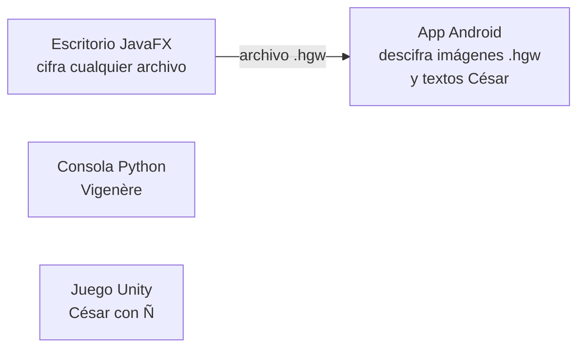

# Reto 02 · El Guardián Iván

Proyecto del Reto 02 para **cifrar y descifrar información** con varios algoritmos (Vigenère, César y AES) desde cuatro aplicaciones distintas: una de consola en Python, una de escritorio en JavaFX, una app Android y un minijuego en Unity. Todo el proyecto tiene una ambientación de Hogwarts.

**Autores:** Iván Salazar e Iván Alonso · **Curso:** 2026–2027

## Índice

1. [Qué hay en el repositorio](#qué-hay-en-el-repositorio)
2. [Cómo encajan las piezas](#cómo-encajan-las-piezas)
3. [Empezar rápido](#empezar-rápido)
4. [Estructura de carpetas](#estructura-de-carpetas)
5. [Calidad e integración continua](#calidad-e-integración-continua)
6. [Cómo trabajamos con Git](#cómo-trabajamos-con-git)
7. [Autores](#autores)

## Qué hay en el repositorio

Cada módulo es un proyecto independiente, con sus propias herramientas y su propio README. Este archivo solo da la visión general: los detalles de instalación, uso y arquitectura están en el README de cada uno.

| Módulo | Qué hace | Algoritmo | Tecnología | Documentación |
| --- | --- | --- | --- | --- |
| **Python** | Aplicación de consola para cifrar y descifrar mensajes escritos o archivos `.txt`, incluso muy grandes. | Vigenère | Python 3.14, pytest, Ruff, Black | [crypto-python/README.md](crypto-python/README.md) |
| **Escritorio** | Aplicación con ventana para cifrar y descifrar cualquier archivo con contraseña. Genera archivos `.hgw`. | AES-256-GCM | Java 21, JavaFX, Maven | [desktop-javafx/El_Guardian_Ivan/README.md](desktop-javafx/El_Guardian_Ivan/README.md) |
| **Android** | App móvil para descifrar órdenes en `.txt` (César) e imágenes `.hgw` creadas con la app de escritorio. No cifra. | César y AES-256-GCM | Kotlin, Android 8.0+ | [android-app/README.md](android-app/README.md) |
| **Unity** | Minijuego 2D *La Puerta del Castillo*: hay que descifrar los mensajes de los enemigos antes de que rompan la puerta. Cinco niveles y un jefe final. | César (con Ñ) | Unity 6, C# | [juego-unity/README.md](juego-unity/README.md) |

Las aplicaciones de escritorio, Android y Unity están disponibles en español, inglés y euskera. La de consola en Python está en español.

## Cómo encajan las piezas

La mayoría de módulos funcionan por separado. La única conexión entre ellos es el formato **`.hgw`**: la app de escritorio cifra un archivo con AES y la app Android puede descifrarlo si es una imagen.



El formato `.hgw` (cabecera, derivación de la clave y cifrado por bloques) está descrito en [docs/formato-hgw.md](docs/formato-hgw.md), para que cualquier plataforma pueda leerlo.

> El César de Android usa el alfabeto inglés de 26 letras, y el del juego de Unity usa el español de 27 (con Ñ). Por eso un mensaje cifrado en uno no siempre se descifra igual en el otro.

## Empezar rápido

Primero se clona el repositorio:

```bash
git clone https://github.com/dm2-ethazi/Reto2-El_Guardian_Ivan.git
cd Reto2-El_Guardian_Ivan
```

Después, cada módulo se abre por su cuenta. Estos son los requisitos mínimos y la forma más corta de arrancarlo; los pasos completos están en su README.

| Módulo | Necesitas | Para arrancarlo |
| --- | --- | --- |
| Python | Python 3.14 o superior | En `crypto-python/`: `python -m pip install -e .` y después `python main.py` |
| Escritorio | JDK 21 (Maven viene incluido con el wrapper) | En `desktop-javafx/El_Guardian_Ivan/`: `.\mvnw.cmd clean javafx:run` (Windows) o `./mvnw clean javafx:run` |
| Android | Android Studio y el SDK de Android | Abrir la carpeta `android-app/` en Android Studio y pulsar **Run** |
| Unity | Unity 6000.3.24f1 desde Unity Hub | Añadir la carpeta `juego-unity/` en Unity Hub, abrir la escena `MenuPrincipal` y pulsar **Play** |

## Estructura de carpetas

```text
Reto2-El_Guardian_Ivan/
├── crypto-python/            Módulo Python (Vigenère)
├── desktop-javafx/
│   └── El_Guardian_Ivan/     Aplicación de escritorio JavaFX (AES)
├── android-app/              Aplicación Android (César y AES)
├── juego-unity/              Minijuego Unity (César)
├── docs/
│   └── formato-hgw.md        Especificación del formato de archivo cifrado .hgw
├── .github/workflows/        Integración continua con GitHub Actions
├── .githooks/                Hooks de Git compartidos por el equipo
└── README.md                 Este archivo
```

## Calidad e integración continua

Cada módulo tiene sus propias pruebas automáticas:

| Módulo | Pruebas | Cómo se ejecutan |
| --- | --- | --- |
| Python | pytest, con cobertura mínima del 80 %, Ruff y Black | Automáticamente en GitHub Actions y a mano desde `crypto-python/` |
| Escritorio | JUnit | `mvnw test` desde `desktop-javafx/El_Guardian_Ivan/` |
| Unity | Unity Test Framework (EditMode y PlayMode) | Desde el Test Runner del editor o por línea de comandos |
| Android | Comprobaciones funcionales en dispositivo o emulador | Ver la tabla del README de Android |

### GitHub Actions (módulo Python)

El workflow [`.github/workflows/python-ci.yml`](.github/workflows/python-ci.yml) se lanza en cada **push** y en cada **Pull Request**. En un runner de Ubuntu con Python 3.14.7:

1. Instala las dependencias de desarrollo de [`crypto-python/pyproject.toml`](crypto-python/pyproject.toml).
2. Ejecuta las pruebas con pytest y comprueba que la cobertura, incluidas las ramas, llega al **80 %**.
3. Revisa el código con **Ruff** y el formato con **Black**.

En la validación local se superaron **74 pruebas** con una cobertura del **90,77 %**, sin errores de Ruff ni de Black. La primera ejecución del workflow en GitHub terminó con estado **Success**.

Se valoró usar **act** para ejecutar el workflow en local con Docker, pero de momento no se usa: las comprobaciones ya se pueden lanzar una a una desde el entorno de Python, y añadir Docker solo para esto complicaría la instalación.

Los comandos para repetir estas comprobaciones en local están en el [README de Python](crypto-python/README.md#8-integración-continua-y-calidad).

## Cómo trabajamos con Git

### Ramas

- `main`: versiones estables.
- `develop`: rama donde se juntan las funcionalidades terminadas.
- `feature/*`, `fix/*` y `docs/*`: nuevas funcionalidades, correcciones y documentación.

`main` y `develop` están protegidas en GitHub: los cambios solo entran mediante Pull Request.

### Pasos para hacer un cambio

1. Actualizar `develop`.
2. Crear una rama nueva a partir de `develop` (por ejemplo `feature/nombre-del-cambio`).
3. Hacer los cambios y los commits.
4. Subir la rama a GitHub y abrir una Pull Request hacia `develop`.
5. El otro integrante revisa la Pull Request y, si está bien, se fusiona.
6. Cuando `develop` tiene una versión estable, se fusiona en `main`.

### Mensajes de commit

Se escriben en imperativo y empiezan por un prefijo que indica el tipo de cambio. Entre paréntesis se puede añadir el módulo afectado.

| Prefijo | Uso |
| --- | --- |
| `feat:` | Nueva funcionalidad |
| `fix:` | Corrección de errores |
| `docs:` | Documentación |
| `test:` | Pruebas |
| `chore:` | Mantenimiento y configuración |

Ejemplos: `feat: implementar cifrado Vigenere`, `docs(python): actualizar README del modulo Vigenere`.

### Hooks de Git

La carpeta [`.githooks`](.githooks) contiene dos hooks:

- **pre-commit**: si existe una carpeta `tests` en el directorio desde el que se hace el commit, ejecuta pytest y cancela el commit cuando alguna prueba falla.
- **pre-push**: impide hacer push directamente a `main` o `develop`.

Cada integrante los activa una sola vez, desde la raíz del repositorio:

```bash
git config core.hooksPath .githooks
```

Para comprobar que están activos:

```bash
git config --get core.hooksPath
```

### Organización de tareas

Las tareas se organizan en **GitHub Projects**. Cada funcionalidad tiene su Issue y pasa por estos estados: **Backlog** (pendiente de planificar), **Ready** (lista para empezar), **In progress** (en desarrollo), **Review** (en revisión) y **Done** (terminada). Los cambios de cada Issue se integran mediante Pull Request.

## Autores

- **Iván Salazar**
- **Iván Alonso**
