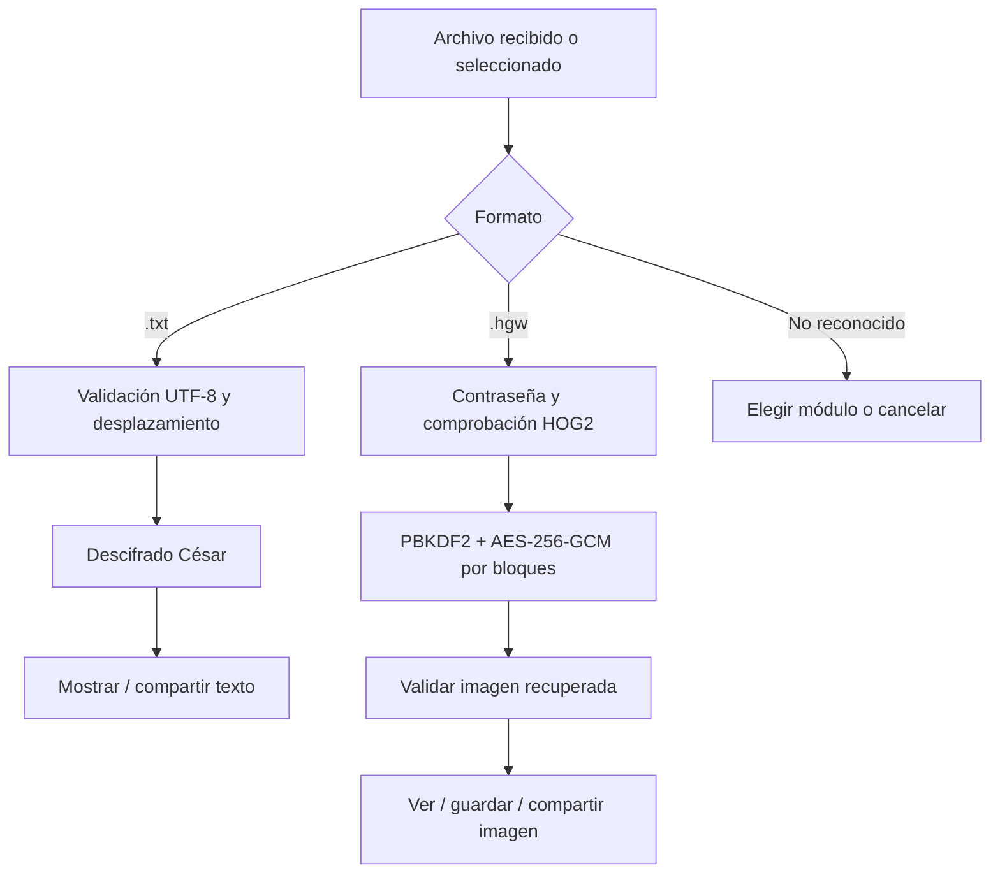

# El Guardián Iván — Aplicación Android

> Cliente móvil nativo del **Reto 02 — El Guardián Iván**. Diseñado para que un *Auror* pueda consultar y descifrar información recibida sobre el terreno.

**Versión de la aplicación:** `1.7` (`versionCode 7`) · **Plataforma:** Android 8.0+ (API 26) · **Lenguaje:** Kotlin · **Interfaz:** XML + AndroidX + Material Components

---

## 1. Descripción

La aplicación Android es el cliente móvil de **consulta y descifrado** del sistema desarrollado para el Reto 02. Permite recuperar órdenes de batalla cifradas con **César** y visualizar imágenes protegidas mediante **AES-256-GCM**, sin necesitar la aplicación de escritorio para operar una vez que el archivo cifrado ya está disponible en el dispositivo.

El cliente móvil **no cifra archivos ni genera mensajes nuevos**. Su papel es interpretar información creada o recibida por otros componentes del proyecto.

### Funcionalidades implementadas

| Funcionalidad | Comportamiento |
| --- | --- |
| **Descifrado César** | Lee archivos `.txt` en UTF-8, aplica un desplazamiento introducido por el usuario y muestra el texto recuperado. |
| **Descifrado de imágenes AES** | Abre archivos cifrados `.hgw` en formato **HOG2**, solicita la contraseña y recupera imágenes PNG, JPEG o WebP. |
| **Importación de documentos** | Utiliza el selector de archivos de Android (*Storage Access Framework*). |
| **Recepción desde otras aplicaciones** | Admite archivos recibidos mediante **Compartir** (`ACTION_SEND`). |
| **Resultados** | Permite compartir texto y previsualizar, guardar o compartir las imágenes descifradas. |
| **Configuración** | Permite elegir español, euskera o inglés y activar/desactivar la confirmación previa al compartir resultados. |
| **Gestión de incidencias** | Valida formato, contenido, desplazamiento y contraseña, mostrando mensajes de error en pantalla. |

> **Importante sobre los formatos:** la **entrada AES** de esta implementación es un archivo **`.hgw`**, no un `.png` cifrado de forma genérica. El archivo `.hgw` contiene una imagen cifrada por la aplicación JavaFX; al descifrarlo, Android recupera y muestra su formato original (`.png`, `.jpg`, `.jpeg` o `.webp`). El contenedor está especificado en [`docs/formato-hgw.md`].

## 2. Requisitos técnicos

| Componente | Versión o configuración declarada |
| --- | --- |
| Sistema operativo | Android 8.0 o posterior (**minSdk 26**) |
| `compileSdk` / `targetSdk` | API **37** / **37** |
| Lenguaje | Kotlin |
| Compatibilidad de Java | Java **11** (source/target del módulo) |
| JDK de Gradle | **21**, según `gradle/gradle-daemon-jvm.properties` |
| Android Gradle Plugin | **9.3.3** |
| Gradle Wrapper | **9.5.0** |
| Identificador del paquete | `com.elguardian.ivan` |
| Módulo de Gradle | `:app` |
| Bibliotecas principales | AndroidX AppCompat, Activity KTX, Core KTX, ConstraintLayout y Material Components |

Para compilar se necesita **Android Studio**, el **SDK de Android correspondiente** y un entorno compatible con las versiones de Gradle y AGP declaradas en el repositorio. Las dependencias se gestionan mediante `gradle/libs.versions.toml`.

## 3. Instalación y ejecución

### 3.1. Desde el código fuente

1. Clona el repositorio:

   ```bash
   git clone https://github.com/dm2-ethazi/Reto2-El_Guardian_Ivan.git
   cd Reto2-El_Guardian_Ivan
   ```

2. Abre **Android Studio** y selecciona **Open**.
3. Abre la carpeta **`android-app/`** como proyecto independiente de Gradle.
4. Deja que Gradle sincronice el proyecto e instala el SDK solicitado si Android Studio lo indica.
5. Selecciona un emulador compatible o conecta un dispositivo Android con la depuración USB habilitada.
6. Selecciona la configuración **`app`** y pulsa **Run**.

No hace falta abrir `crypto-python/`, `desktop-javafx/` o `juego-unity/` para iniciar el cliente Android.

### 3.2. Generar un APK de desarrollo

Ejecuta estos comandos **desde `android-app/`**:

**Windows (PowerShell)**

```powershell
.\gradlew.bat :app:assembleDebug
```

Si la compilación finaliza correctamente, Gradle genera normalmente:

```text
android-app/app/build/outputs/apk/debug/app-debug.apk
```

Para instalarlo en un dispositivo reconocido por ADB:

```powershell
# Windows (PowerShell)
.\gradlew.bat :app:installDebug
```

El APK de depuración permite instalar la aplicación para desarrollo y demostraciones. Para distribuir una versión definitiva, es necesario generar y firmar una compilación de publicación. El nombre del archivo final dependerá del proceso de empaquetado que utilice el equipo.

### 3.3. Instalar un APK ya generado

En un dispositivo Android compatible, abre un APK proporcionado por el equipo, autoriza la instalación desde esa fuente si Android lo solicita y confirma **Instalar**. Descarga o recibe APK únicamente desde una fuente de confianza.

## 4. Manual de uso

### 4.1. Descifrar una orden de batalla con César (`.txt`)

1. En **Inicio**, entra en **César**.
2. Pulsa **Examinar** y selecciona un archivo `.txt`.
3. Introduce el **desplazamiento** aplicado al mensaje.
4. Pulsa **Descifrar**.
5. Lee el resultado en pantalla y, si procede, usa **Compartir texto**.

**Comportamiento del algoritmo:**

- Desplaza únicamente las letras ASCII `A–Z` y `a–z`.
- Preserva espacios, saltos de línea, números, signos y caracteres fuera del alfabeto ASCII (por ejemplo, `ñ` y letras acentuadas).
- Normaliza el desplazamiento módulo 26; admite desplazamientos negativos siempre que sean enteros válidos.
- Exige un archivo `.txt` con contenido **UTF-8** válido; admite una marca BOM UTF-8 inicial.
- Rechaza documentos vacíos, compuestos solo por espacios, con caracteres de control no permitidos o de más de **2 MiB**.

**Ejemplo**

```text
Archivo cifrado:   KROD PXQGR
Desplazamiento:    3
Texto recuperado:  HOLA MUNDO
```

### 4.2. Descifrar una imagen AES (`.hgw`)

1. Obtén un archivo de imagen cifrada **`.hgw`**, generado con el cifrador compatible del cliente JavaFX.
2. En **Inicio**, entra en **AES** y pulsa **Examinar**.
3. Selecciona el archivo `.hgw`.
4. Escribe **la misma contraseña** utilizada al cifrarlo.
5. Pulsa **Descifrar**.
6. En **Resultado**, elige **Ver imagen**, **Guardar imagen** o **Compartir**.

La app comprueba el contenedor, autentica los bloques cifrados y valida que el contenido recuperado sea una imagen decodificable. No acepta cualquier archivo AES: debe cumplir el protocolo **HOG2** del proyecto.

La operación AES se realiza fuera del hilo principal y muestra un indicador mientras procesa el archivo.

### 4.3. Recibir documentos mediante «Compartir»

Desde otra aplicación de Android, utiliza **Compartir → El Guardián Iván** sobre el archivo que quieras analizar.

- Si el nombre termina en **`.txt`**, se abre el módulo **César**.
- Si termina en **`.hgw`**, se abre el módulo **AES**.
- Si no se reconoce la extensión, se solicita elegir el tipo de descifrado.

La recepción se implementa con `Intent.ACTION_SEND` y la importación con `ActivityResultContracts.OpenDocument`.

### 4.4. Ajustes

En **Ajustes** están disponibles:

- **Idioma:** español (`es`), euskera (`eu`) e inglés (`en`). La selección se conserva en las preferencias de la aplicación.
- **Confirmación antes de compartir:** activada por defecto; muestra una confirmación antes de enviar el texto o la imagen descifrados a otra aplicación.

## 5. Arquitectura y organización del proyecto

La aplicación separa la lógica criptográfica de las pantallas, la gestión de archivos y la configuración.

```text
android-app/
├── app/
│   ├── build.gradle.kts
│   └── src/
│       └── main/
│           ├── AndroidManifest.xml
│           ├── java/com/elguardian/ivan/
│           │   ├── app/
│           │   │   └── GuardianApplication.kt
│           │   ├── crypto/
│           │   │   ├── CesarCipher.kt
│           │   │   ├── CesarTextValidator.kt
│           │   │   └── HgwDecryptor.kt
│           │   ├── ui/
│           │   │   ├── GuardianActivity.kt
│           │   │   ├── MainActivity.kt
│           │   │   ├── CesarActivity.kt
│           │   │   ├── AesActivity.kt
│           │   │   ├── ResultActivity.kt
│           │   │   └── SettingsActivity.kt
│           │   └── utils/
│           │       └── FileUtils.kt
│           └── res/
│               ├── layout/          # Vistas verticales
│               ├── layout-land/     # Adaptaciones horizontales
│               ├── drawable/        # Imágenes y recursos de interfaz
│               ├── values/          # Textos y estilos en español
│               ├── values-eu/       # Euskera
│               ├── values-en/       # Inglés
│               └── xml/             # FileProvider y reglas de backup
├── docs/
│   └── formato-hgw.md
├── gradle/
│   ├── libs.versions.toml
│   └── wrapper/
├── build.gradle.kts
├── settings.gradle.kts
├── gradlew
└── gradlew.bat
```

| Componente | Responsabilidad |
| --- | --- |
| `MainActivity` | Pantalla de inicio, navegación inicial y recepción de archivos compartidos. |
| `CesarActivity` | Selección de `.txt`, validación de desplazamiento, lectura y presentación del texto. |
| `AesActivity` | Selección de `.hgw`, contraseña, descifrado y gestión de progreso/errores. |
| `ResultActivity` | Vista previa, guardado mediante selector de destino y compartición de imágenes. |
| `SettingsActivity` | Preferencias de idioma y confirmación antes de compartir. |
| `GuardianActivity` | Comportamiento común de navegación y adaptación a barras del sistema. |
| `CesarCipher` / `CesarTextValidator` | Algoritmo César y validación estricta de archivos de texto. |
| `HgwDecryptor` | Lectura y descifrado del contenedor interoperable **HOG2**. |
| `FileUtils` | Obtención de nombre y tamaño de archivos mediante `ContentResolver`. |
| `GuardianApplication` | Inicialización del idioma guardado. |

### Flujo funcional



## 6. Interoperabilidad y diseño criptográfico

El módulo Android **descifra** los archivos producidos por `AesFileCipher.java` en `desktop-javafx/`. Ambos componentes están diseñados alrededor del formato propio **HOG2** (`.hgw`).

| Parámetro HOG2 | Especificación |
| --- | --- |
| Algoritmo | `AES/GCM/NoPadding` — **AES-256-GCM** |
| Derivación de clave | `PBKDF2WithHmacSHA256` |
| Iteraciones | **200 000** |
| Sal criptográfica | **16 bytes** |
| Nonce base | **12 bytes** |
| Etiqueta de autenticación | **16 bytes** por bloque |
| Cabecera | **37 bytes**: `HOG2`, versión, sal, nonce y tamaño de bloque |
| Tamaño de bloque al cifrar en JavaFX | **1 MiB** por defecto |
| Tamaño de bloque admitido al leer | De **1 byte a 64 MiB**, según la cabecera |
| Metadatos cifrados | Extensión original (longitud y bytes) antes del contenido |

En cada bloque se emplean un nonce derivado del índice y datos adicionales autenticados (*AAD*) con la cabecera, el índice y el indicador de último bloque. Si la verificación GCM falla, el descifrado se cancela.

**Alcance:** Android únicamente publica resultados que correspondan a una imagen con extensión `png`, `jpg`, `jpeg` o `webp` y que pueda decodificar. No se trata de un descifrador genérico para todos los tipos de archivo que puede manejar JavaFX.

## 7. Seguridad y privacidad

- **Acceso acotado a documentos:** la aplicación utiliza el selector del sistema y URI gestionadas por `ContentResolver`, sin solicitar permiso general para leer todo el almacenamiento.
- **Sin contraseña persistida en preferencias:** la contraseña se usa para el descifrado; la pantalla AES la limpia al completar la operación correctamente.
- **Comprobación de integridad:** AES-GCM permite detectar contraseñas incorrectas y alteraciones del contenedor.
- **Compartición controlada:** el texto se comparte con `ACTION_SEND`; las imágenes utilizan `FileProvider` con un permiso temporal de lectura.
- **Resultados de imágenes temporales:** se escriben en la caché privada `cacheDir/descifrados/`, no en la galería pública automáticamente. Los archivos con antigüedad superior a **24 horas se eliminan al iniciar otro descifrado AES**; no existe una eliminación programada exactamente al cumplirse ese plazo.
- **Guardado explícito:** guardar una imagen requiere que el usuario elija un destino mediante el selector de documentos de Android.

## 8. Gestión de errores y límites

| Situación | Respuesta implementada |
| --- | --- |
| Archivo César vacío, ilegible o no UTF-8 | Aviso en pantalla y cancelación de la operación. |
| Archivo César mayor de **2 MiB** | Rechazo controlado para limitar el consumo de memoria. |
| Desplazamiento no numérico | Error de validación; no se descifra. |
| Archivo AES sin extensión `.hgw` o de tamaño cero | Rechazo de la selección. |
| Cabecera HOG2 incorrecta, archivo truncado o formato incompatible | Error controlado sin mostrar un resultado inválido. |
| Contraseña AES incorrecta o datos manipulados | Error de autenticación y descarte de la salida provisional. |
| Imagen recuperada no reconocible | Se elimina el resultado y se informa del problema. |
| Falta de memoria, fallo de guardado o compartición | Se muestra un aviso; la operación no se da por completada. |

El descifrador AES lee y autentica por bloques, pero el consumo de memoria depende del tamaño de bloque declarado en la cabecera, de los recursos del dispositivo y de la imagen mostrada.

## 9. Comprobación funcional

La compilación puede verificarse desde la carpeta `android-app/` mediante Gradle:

**Windows (PowerShell)**

```powershell
.\gradlew.bat :app:assembleDebug
```

Además de compilar, se recomienda comprobar los recorridos principales en un dispositivo o emulador Android compatible:

| Comprobación | Comportamiento esperado |
| --- | --- |
| Abrir un `.txt` y descifrarlo con César | Se recupera el texto con el desplazamiento introducido. |
| Introducir desplazamientos `0`, `26` o negativos | El cálculo se normaliza correctamente al alfabeto ASCII. |
| Seleccionar un `.txt` vacío, no UTF-8 o mayor de 2 MiB | Se muestra un aviso sin cerrar la aplicación. |
| Recibir un archivo desde «Compartir» | La aplicación abre César o AES según la extensión. |
| Descifrar un `.hgw` creado por JavaFX | Se recupera y visualiza la imagen original. |
| Introducir una contraseña AES incorrecta o un archivo dañado | Se informa del error y no se presenta una imagen inválida como resultado. |
| Guardar o compartir una imagen recuperada | El destino recibe el archivo con el formato adecuado. |
| Cambiar el idioma o girar el dispositivo | La interfaz se adapta y mantiene un uso coherente. |

Esta tabla describe **comprobaciones recomendadas**, no resultados de ejecución previamente acreditados.

## 10. Consideraciones y limitaciones

- **Formato de entrada AES:** el módulo descifra imágenes encapsuladas en archivos `.hgw` con formato **HOG2**; no interpreta archivos `.png` cifrados mediante otros formatos AES.
- **Tipos de imagen admitidos:** PNG, JPEG y WebP. Un `.hgw` que contenga otro tipo de fichero se rechaza para su visualización.
- **Tamaño de texto César:** máximo **2 MiB** por documento.
- **Recursos del dispositivo:** el consumo de memoria del descifrado AES depende del tamaño de bloque indicado en el contenedor y de la imagen procesada.
- **Caché y copias de seguridad:** los resultados descifrados se almacenan temporalmente en la caché privada; antes de utilizar información sensible real conviene revisar las reglas de copia de seguridad configuradas para la aplicación.
- **Distribución:** la generación de un APK de depuración está documentada; la publicación de una versión firmada debe gestionarse por separado.

## 11. Equipo y documentación

**Proyecto:** Reto 02 — *El Guardián Iván*  
**Integrantes:** Iván Alonso e Iván Salazar  
**Curso:** 2026–2027
